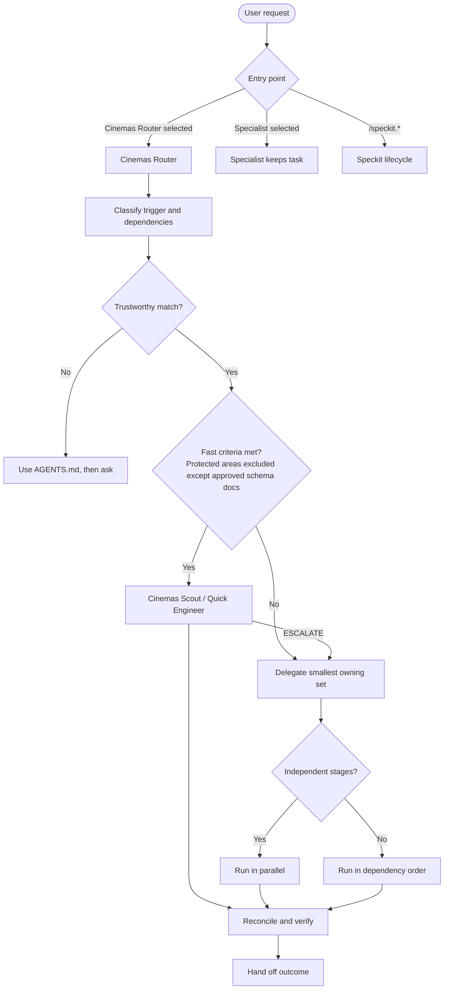
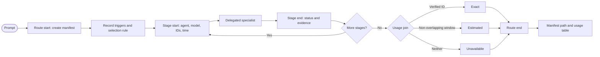

# Routing Diagrams

Sources of truth, in order:

1. `.ai/agents/definitions/Cinemas Router.agent.md`
2. `.ai/agents/agents-role.yaml` (`umbrellaRouting`, `modelTiers`, and `triggerRouting`)
3. `.ai/agents/AGENTS.md`
4. `.ai/agents/ROUTING-TELEMETRY.md`

If a diagram conflicts with a source, the source wins.

Fully specified edits recording approved schema decisions go directly to the MAI-backed
Quick Engineer, in up to three named linked documentation files. This permits prose, approval
labels, and diagram annotations, not SQL edits or new design. Schema design, migrations,
and repairs go to Database Engineer. Neither path uses nested delegation for the same task.

## Retained telemetry lifecycle (disabled)

The diagram below is reference only. With `umbrellaRouting.telemetry.enabled: false`,
skip the entire telemetry lifecycle and preserve existing records without updates.

