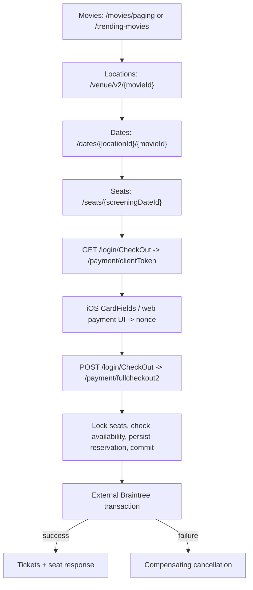
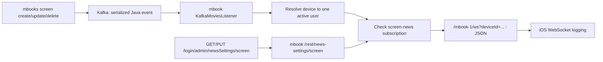

# iOS/backend dependency map

Source relationships, not proof that every runtime path succeeds.
Exact fields and envelopes are in the [contract reference](endpoint-contract-analysis.md).

## Browse to checkout

`/venue/v2` returns locations; do not confuse `locationId`, `venuesId`, `screen_screenId`
and `screeningDatesId`. Date DTOs use `screeningDatesId`/`screeningDate`.
Location-first browsing uses `/locations` then `/venue/movies?locationId=...`, returning
`movies` plus singular `venue` before date selection.

No database lock is held through the external payment call. Timestamp order IDs are not
evidence of idempotency. Preserve error handling and cancellation across these boundaries.

## Purchases

| Action | Gateway | Downstream mbooks path |
|--------|---------|------------------------|
| List | GET `/login/GetAllPurchases` | `/book/purchases` |
| Tickets | GET `/login/ManagePurchases?purchaseId=...` | `/book/purchases/tickets` |
| Cancel selected tickets | POST `/login/ManagePurchases`, with `ticketsToBeCancelled` | `/book/managepurchases` |
| Delete purchase | POST `/login/ManagePurchases`, cancellation field absent | `/book/deletepurchases` |

Downstream paths are under `/mbooks-1/rest`. The gateway forwards session ownership/headers;
clients should not replace these routes with `/login/purchases/...` or HTTP DELETE.
Deletion is not evidence of a Braintree refund.

## Screen events

Ambiguous/unresolved active ownership or disabled subscriptions skip screen-news delivery.
Legacy user notifications retain a separate broadcast path. WebSocket event `category`
means `"screening"`, not movie category; producer/consumer Java models and client JSON
must be considered separately.

## Client composition and evidence

iOS `AppDelegate` -> `AppServices` -> async services -> `APIClient`/`Endpoint`.
Data managers parse responses; UIKit/SwiftUI screens consume their models.
The embedded web-login cookie bridge participates in native session state.

Evidence: mbooks `rest/` controllers, `service/CheckoutService.java`, `db/DAO.java` and
`broadcasting/`; mbook `broadcasting/` and `service/NewsSettingsService.java`;
dalogin `servlets/CheckOut.java`, `GetAllPurchases.java`, `ManagePurchases.java`,
`AdminServlet.java`; iOS `Networking/BackendServices.swift`, `DataManagers/`,
`BroadCasting/Websocket.swift` under `SwiftCinemas/SwiftLoginScreen/`.
