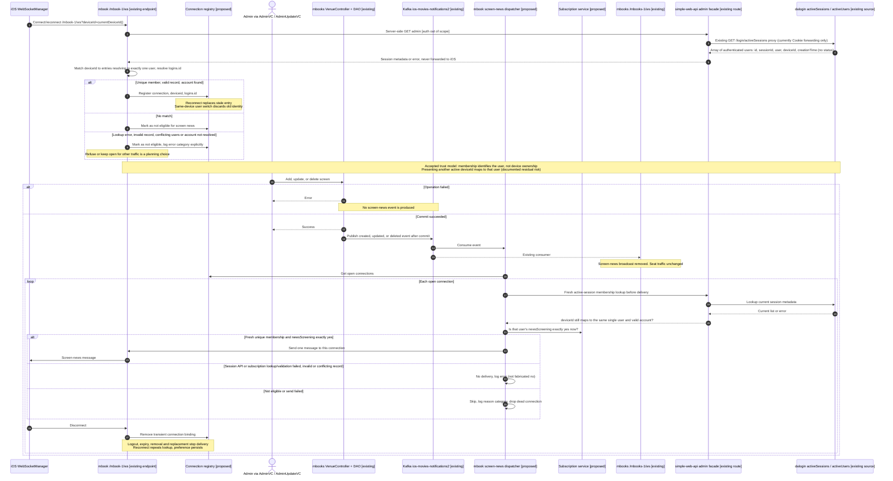

# Architecture: Subscription-Filtered Screen News over WebSocket

**Spec**: [`speckit.system.screen-news-websocket-subscriptions.specify`](./speckit.system.screen-news-websocket-subscriptions.specify)  
**Database schema**: [Current baseline, approved owner constraints and pending hardening](./speckit.system.screen-news-websocket-subscriptions.database-schema.md)  
**Created**: 2026-10-03  
**Status**: Draft (target architecture for planning; no implementation)  
**Updated**: 2026-10-04 — required new mbook persistence endpoint; existing deviceid and verified simple-web-api lookup boundary; user-directed correction: active-list membership is sufficient WebSocket identity (no caller-session binding)  
**Owner constraints**: USER-APPROVED REQUIRED target: `logins_id NOT NULL` + `UNIQUE (logins_id)`; not deployed. Preference-column NOT NULL/default/CHECK remain pending approval.  
**Contract IDs**: `CID-MBOOK-WS-SCREEN-NEWS` (planned), subscription read/write endpoint (planned, CID assigned in planning), `CID-MBOOKS-SEATS` (referenced, unchanged)

## Purpose and reading guide

This document shows the components and data flows the approved spec needs, including the
user-directed scope for FR-015: users manage the screen-news subscription from the **iOS menu screen**.

Labels used in the diagrams:

- **[existing]**: the component exists today. Evidence is listed in the table below.
- **[proposed]**: a responsibility this feature needs. Its name, endpoint path, payload, and physical
  constraint deployment are **planning decisions**, not deployed facts. Shared `login_.news_settings`
  storage and exact lowercase `newsScreening='yes'`/`'no'` are decided by user correction (2026-10-03).
  Owner NOT NULL/UNIQUE are now user-approved required target constraints, not optional proposals;
  their deployment still requires planning. Preference-column NOT NULL/default/CHECK remain pending.

## Evidence baseline (current state)

| Component | Evidence |
|---|---|
| iOS menu screen | `SwiftCinemas/SwiftLoginScreen/MenuVC.swift`: UIKit `MenuVC` with profile card (username, email, picture via `AuthDataManager.shared.fetchUserProfile()`), `Admin` button, `Back`/`Purchases` nav, logout. Uses the cookie-backed `URLSession.sharedCustomSession`. No news control today. |
| iOS WebSocket client | `BroadCasting/Websocket.swift` `WebSocketManager`, owned by `AppDelegate`. Connects to `URLManager.webSocketURL` (`/mbook-1/ws`), sends no client ID, prints received text, pings every 30 s, reconnects after 3 s. |
| Existing iOS deviceid source | `SwiftCinemas/SwiftLoginScreen/ciphertext.swift:currentDeviceId()` uses `UIDevice.current.identifierForVendor?.uuidString ?? ""`; `LoginVC.swift` passes it to sign-in; `Networking/BackendServices.swift` sends/saves `deviceId`. Reuse this value on connect/reconnect, no new app-ID generator. Empty ID fails eligibility; persistence across reinstalls/vendor changes is not guaranteed. |
| simple-web-api lookup facade | Actual owner `simple-service-webapp-quarkus`, `src/main/resources/application.properties` root `/simple-service-webapp`, REST `/webapi`; `src/main/java/com/example/rest/ImageResource.java:getSessions` exposes **GET `/simple-service-webapp/webapi/myresource/admin`**. Forwards incoming Cookie to `admin.service-url` + `/login/activeSessions`, relays status/body, IO error => 502. Not a database-backed session source or DTO serialization. |
| Active-session source and fields | `dalogin-quarkus/src/main/java/com/dalogin/servlets/ActiveSessionsServlet.java`: **GET `/login/activeSessions`**, ServletContext `activeUsers` => array of `id` (list index, not account id), `sessionId`, `user`, `deviceId`, `creationTime`; no status/active/expiry field. Missing attributes become empty strings; caught invalidated sessions skipped. `simple-service-webapp-quarkus/.../api/Sessions.java:getSessions()` is unused by this proxy and does not define the upstream field names. |
| Session lifecycle/account mapping | `dalogin-quarkus/.../listeners/CustomHttpSessionListener.java` registers at session creation before login, attempts old-session eviction per deviceId and destruction cleanup; `HelloWorld.java:createSession` sets user/deviceId after successful login persistence, 30-minute inactivity timeout. User-confirmed (2026-10-04): list entries are authenticated users, so fresh membership is the WebSocket identity source; blank user/deviceId entries are invalid; creationTime is not expiry proof. Map is ServletContext-local. `mbook-quarkus/.../db/DAO.java:getUser` queries Logins by user, returns id-zero sentinel if missing; `.../api/Logins.java:getId` identifies account. Resolve numeric `logins.id`, never array id/deviceId/uuid. |
| Internal service authorization not established | Neither `ImageResource.getSessions` nor `ActiveSessionsServlet.doGet` checks caller/service authorization. `dalogin-quarkus/.../filters/AuthFilter.java` maps `/admin/*` and named other routes, not `/activeSessions`; `src/main/resources/META-INF/web.xml` adds no security mapping. Existing facade only forwards Cookie. Protected server-to-server access to both hops, freshness and replica coverage are REQUIRED planning prerequisites. This secures the admin list itself; it is not a WebSocket caller-session binding requirement. |
| iOS admin triggers | `AdminVC`, `AdminUpdateVC` → `mbooks-quarkus` `VenueController` add/update/delete screen → `DAO.insertNewScreen/updateScreen/deleteScreen`. |
| Event channel | Kafka topic `ios-movies-notifications2`. Produced by `mbooks-quarkus` `KafkaMessageProducer` (add only, `AddMovie` fields). Consumed by `mbook-quarkus` `KafkaMoviesListener` and `mbooks-quarkus` `KafkaListener`. |
| WebSocket endpoints | `com.jeet.broadcasting.WebSocketServer` in both `mbook-quarkus` (`/mbook-1/ws`) and `mbooks-quarkus` (`/mbooks-1/ws`). Both broadcast screen-add news to every session. `/mbooks-1/ws` also carries documented seat traffic. |
| Subscription storage | `mbook-quarkus` entity `NewsSettings` (`news_settings.newsScreening`, linked to `logins`); no reader or writer exists. Designated snapshot `k8infra/mysql_8/Dump20260524.sql:372–379`: signed INT auto-increment `id` PK, nullable `VARCHAR(255)` newsScreening, nullable/non-unique indexed signed INT `logins_id` FK to signed `logins.id`; InnoDB/utf8mb3, collation unspecified, unlike logins' explicit utf8mb3_bin; no settings trigger (root `mysql_8/login.sql` lacks this table: script drift). User-decided target is shared per-user settings with exact `yes`/`no` text, not row-presence eligibility. Owner `logins_id NOT NULL` + `UNIQUE (logins_id)` are USER-APPROVED REQUIRED target, not deployed. Preference-column NOT NULL/default/CHECK remain pending approval. |
| Out-of-scope traffic to preserve | `mbook-quarkus` `ios-users-notifications` (`KafkaListener`/`KafkaMessageProducer`), persisted `events` and `/news/{user}`. |

## 1. Component and data-flow view

```mermaid
flowchart LR
    subgraph IOS["iOS app - SwiftCinemas"]
        MENU["MenuVC - iOS menu screen<br/>[existing UIKit screen]<br/>+ screen-news on/off control [proposed]"]
        PREFCLIENT["BackendServices getNewsScreen / putNewsScreen<br/>[planned] GET/PUT /login/admin/newsSettings/screen<br/>{enabled: bool}"]
        DEVICE["currentDeviceId [existing]<br/>identifierForVendor uuidString<br/>login parameter deviceId [existing]"]
        WSM["WebSocketManager<br/>[existing, owned by AppDelegate]<br/>+ existing deviceid on connect/reconnect [required, not implemented]<br/>+ created/updated/deleted handling [proposed]"]
        ADMIN["AdminVC / AdminUpdateVC<br/>[existing admin flows]"]
    end

    PROXY["Apache proxy<br/>[existing ProxyPass incl. WebSocket routes]<br/>forwards session cookie for preference API, deviceid for socket"]
    DALOGIN["dalogin AdminServlet [existing, extended]<br/>GET/PUT /login/admin/newsSettings/screen<br/>existing AuthFilter /admin/*; session/token/activation checks<br/>user from HttpSession; adds user, token2, TIME_ headers"]
    AUTH["mbook CookieFilter + CiphertextFilter [existing, path extended]<br/>preference API only; not used for socket identity"]
    SIMPLE["simple-web-api = simple-service-webapp-quarkus<br/>GET /simple-service-webapp/webapi/myresource/admin [existing]<br/>endpoint authorization out of scope"]
    ACTIVE["dalogin GET /login/activeSessions [existing]<br/>ServletContext activeUsers [existing source]<br/>sessionId, user, deviceId, creationTime; id = list index<br/>in-memory, no DB query; fresh per event"]

    subgraph MBOOKS["mbooks-quarkus"]
        VC["VenueController + DAO<br/>add / update / delete screen<br/>[existing]"]
        PUB["Screen-news publisher<br/>[existing for add only]<br/>update + delete [proposed]<br/>after successful commit only"]
        MBWS["/mbooks-1/ws WebSocketServer<br/>seat traffic [existing, unchanged]<br/>screen-news broadcast removed [planned]"]
    end

    KAFKA[["Kafka topic ios-movies-notifications2<br/>[existing event channel]"]]

    subgraph MBOOK["mbook-quarkus - account data and NewsSettings; not dalogin active-session source"]
        PREFAPI["NewsSettingsController [planned]<br/>GET/PUT /mbook-1/rest/news-settings/screen<br/>{enabled: bool}"]
        SUBSVC["Screen-news subscription service<br/>[proposed]"]
        NS[("login_.news_settings [existing shared table]<br/>owner NOT NULL + UNIQUE [approved required, not deployed]<br/>at most one row per account; every row owned<br/>newsScreening: exact yes = on, no = off [decided]<br/>missing row = off; invalid value = error<br/>future category columns preserved")]
        LISTENER["KafkaMoviesListener<br/>[existing consumer]"]
        DISPATCH["Screen-news dispatcher<br/>[proposed, replaces broadcast-to-all]"]
        GATE{"Eligibility gate [proposed]<br/>fresh active-list membership of deviceid?<br/>exactly one authenticated user and logins.id?<br/>newsScreening exactly yes?<br/>no match = no delivery; error/invalid/conflict = no delivery + log"}
        REG["Transient registry [proposed]<br/>connection -> deviceid + membership-resolved logins.id<br/>no new persistent client table"]
        WSS["/mbook-1/ws WebSocketServer<br/>[existing endpoint]"]
        OOS["ios-users-notifications broadcast,<br/>events + /news/{user}<br/>[existing, out of scope, preserved]"]
    end

    MENU -->|"load state / toggle"| PREFCLIENT
    PREFCLIENT -->|"read / write own preference"| PROXY
    PROXY --> DALOGIN
    DALOGIN -->|"user, token2, TIME_, Ciphertext, XSRF cookie"| AUTH
    AUTH --> PREFAPI
    PREFAPI --> SUBSVC
    SUBSVC <-->|"read column / ensure row / set only newsScreening yes or no"| NS

    WSM -->|"connect/reconnect + existing deviceid"| PROXY
    DEVICE -->|"reuse existing deviceid; ?deviceId= query"| WSM
    PROXY --> WSS
    WSS -->|"server-side membership lookup [required integration]"| SIMPLE
    SIMPLE -->|"existing proxy; auth out of scope"| ACTIVE
    ACTIVE -->|"match deviceId to one authenticated user; resolve logins.id"| REG
    WSS -->|"register / remove on close"| REG

    ADMIN -->|"admin screen operation"| VC
    VC -->|"commit succeeded"| PUB
    PUB -->|"created / updated / deleted"| KAFKA
    KAFKA --> LISTENER
    KAFKA -.->|"existing consumer"| MBWS
    LISTENER --> DISPATCH
    DISPATCH --> REG
    DISPATCH --> GATE
    GATE -->|"check current state per event"| SUBSVC
    GATE -->|"fresh membership before delivery"| SIMPLE
    GATE -->|"eligible only"| WSS
    WSS -->|"screen-news message"| WSM
    GATE -.->|"skip + log reason category"| DISPATCH
```



Key rules shown above:

- The preference is always read and written for the **session-resolved user**. The client ID, a
  user name in the request, and the local state of the menu toggle are never trusted as the
  preference or as identity (FR-002, FR-016).
- Deviceid source is decided, transport remains planning. **User-directed (2026-10-04)**: the
  simple-web-api active-session list holds authenticated users, so a supplied deviceid that matches
  entries resolving to exactly one authenticated user identifies that user; map it to one valid
  `logins.id`. No separate WebSocket caller-session binding or socket session credential is required.
  No match => no delivery. Lookup outage/denial, malformed response, invalid record (blank
  user/deviceId), conflicting users, or missing/non-unique account => no delivery with explicit
  logging. No arbitrary match or stale-cache authorization.
  Admin session metadata stays server-side; no list returned to iOS, no unchecked browser/admin
  credential reuse. Authorization of the admin list is out of scope (user-directed 2026-10-04).
  Disconnect removes registration; logout/expiry/removal/replacement invalidate it. Each reconnect
  repeats the lookup, and each event rechecks fresh membership before delivery.
  Same-device user switch cannot retain the old account's identity or preference. The local map
  requires complete replica-aware lookup planning; creationTime supplies no expiry guarantee.
- **Accepted trust assumption and residual risk**: membership establishes the authenticated user
  associated with the deviceid under the accepted trust model, not cryptographic proof that the
  socket sender owns the device. Anyone able to present another user's active deviceId can be mapped
  to that user and receive that user's screen news; no independent spoof protection is claimed.
  The deviceid never authorizes preference reads/writes, which stay on the authenticated endpoint.
- The gate checks the **current** subscription state for each event, so open connections see
  subscription changes without reconnecting (FR-006, FR-007, FR-021). An unsubscribe writes
  `newsScreening='no'` and suppresses only screen-news delivery; it does not close the socket,
  disconnect the device, reconnect it, or remove an otherwise valid registry entry. The same open
  connection remains eligible for other non-news traffic and for independently subscribed categories
  as otherwise permitted. Re-subscribe writes `newsScreening='yes'` and the next screening event is
  delivered on the same socket without reconnecting. Normal socket lifecycle still applies on logout,
  disconnect, session expiry, invalid auth, and transport failures; the feature does not promise a
  kept-open socket for invalid/failed connections.
- Deliver all three event types to every eligible open device across all subscribed users,
  not only the admin/actor's connections. Delivery remains live best-effort; no offline replay
  or new ordering/persistence/retry guarantee is introduced.
- **Storage layout and encoding are decided**: shared `login_.news_settings`, exact lowercase
  `newsScreening='yes'` enables `created`, `updated`, and `deleted` across all the user's clients;
  `no` disables them. Row existence is not eligibility. Subscribe ensures one row and sets only
  this column to `yes`; unsubscribe ensures/sets `no` and retains the row and unrelated columns,
  idempotently. Missing row defaults off; new managed rows default to `no` unless subscribing.
  Future category defaults must not enable anything; this feature adds no other categories (FR-014).
  NULL/unknown/noncanonical values and duplicates fail validation and the delivery gate; log
  error categories without disclosing data and return a menu error, not a silent off/success.
  Lookup failures likewise are errors, never fabricated `no`. Owner `logins_id NOT NULL` +
  `UNIQUE (logins_id)` are **USER-APPROVED REQUIRED target**, not deployed: at most one row per
  account, every settings row owned. They create no rows for missing users; no blanket backfill.
  Preference-column NOT NULL/default/CHECK remain pending approval. Owner-constraint deployment
  requires explicit reviewed reconciliation of NULL/duplicate owners, not silent deletion or
  arbitrary merging, and separate migration planning/authorization.
  Disconnect/logout/session expiry do not delete settings or change the stored preference (FR-020).
  Writes acknowledge success only after commit; unknown commit outcomes require reload (FR-018).
- Messages are produced **only after a successful commit** of the screen operation (FR-005).
  The mechanism that makes publication reliable relative to the commit (for example, an outbox
  or a post-commit hook) is a planning choice. This document does not claim one exists.
- `/mbooks-1/ws` must not bypass the gate (FR-012). Planning chooses whether it stops
  forwarding screen news or applies the same gate. Its seat traffic stays unchanged.

## 2. Sequence: iOS menu opt-in / opt-out

```mermaid
sequenceDiagram
    autonumber
    actor U as User
    participant M as MenuVC [existing + proposed control]
    participant C as Subscription API client [proposed]
    participant P as Apache proxy [existing]
    participant L as dalogin AdminServlet [existing, extended]
    participant R as mbook account-profile API [existing]
    participant A as mbook /rest/news-settings/screen [planned]
    participant S as Subscription service [proposed]
    participant DB as login_.news_settings [shared row, layout decided]

    U->>M: Open menu screen
    M->>M: Show control as loading and disabled
    M->>C: Load screen-news preference
    C->>P: Authenticated read with session cookie
    P->>L: GET /login/admin/newsSettings/screen
    Note over L: Existing /admin/* AuthFilter and performTask unchanged<br/>No added session/token/token2/activation-null guards<br/>Only the active handler selects the new settings call
    alt No valid session
        L-->>C: Rejected by AuthFilter
        C-->>M: Signed-out result
        M->>M: Keep control disabled, show signed-out state, no change attempted
    else Valid session, activation S
        L->>L: Existing handleActivationRequired / prepareActivationRequired
        L->>R: Existing callServiceAndRespond / callGetData
        R-->>L: Account-profile body
        L-->>C: 300, Response: S, X-Token, account-profile body
        C-->>M: Existing activation response handling, not ScreenNews
        M->>M: Keep control disabled; no settings call or mutation
    else Valid session, active handler
        L->>A: GET with user, token2, TIME_ from session
        A->>S: Read preference for session user
        S->>DB: Read newsScreening for session user
        alt Lookup succeeds with canonical value or missing row
            DB-->>S: Exact yes, exact no, or missing row
            S-->>A: Enabled = exact yes, no or missing row = false
            A-->>L: 200 {enabled}
            L-->>C: 200 {enabled}
            C-->>M: Current server state
            M->>M: Show server state and enable control
        else Lookup or value/integrity validation fails
            DB-->>S: Error, not fabricated no
            S-->>A: Error, no enabled boolean
            A-->>C: Error
            C-->>M: Load failed
            M->>M: Keep control disabled, show error or retry, no assumed state
        end
    end

    U->>M: Toggle screen news on or off
    M->>M: Show pending state and block repeat taps
    M->>C: Save requested state
    C->>P: Authenticated write with session cookie
    P->>L: PUT /login/admin/newsSettings/screen {enabled}
    alt No valid session
        L-->>C: Existing AuthFilter rejection
        C-->>M: Failure; no preference change
    else Activation S
        L->>L: Existing handleActivationRequired / prepareActivationRequired
        L->>R: Existing account-profile GET, not settings PUT
        R-->>L: Account-profile body
        L-->>C: 300, Response: S, X-Token, account-profile body
        C-->>M: Existing activation response handling; no success decoding
        M->>M: Revert pending toggle; no preference mutation
    else Active handler
        L->>A: PUT {enabled} with user, token2, TIME_ from existing attributes
        A->>S: Save requested state for session user
        Note over A,S: Require valid session and canonical input<br/>Existing invalid/duplicate data needs explicit review, not silent repair
        alt Subscribe
            S->>DB: Ensure shared row and set only newsScreening to yes
        else Unsubscribe
            S->>DB: Ensure shared row and set only newsScreening to no
        end
        Note over S,DB: Serialize on parent login, idempotent with no duplicates<br/>Retain row and all unrelated columns
        alt Save committed
            DB-->>S: Transaction committed
            S-->>A: Persisted state
            A-->>C: Persisted state
            C-->>M: Success with persisted state
            M->>M: Show persisted state as confirmed
        else Save failed, timed out, or session invalid
            A-->>C: Error or no response
            C-->>M: Failure
            M->>M: Revert to last confirmed state and show error<br/>Reload after ambiguous commit/timeout
        end
    end
```

## 3. Sequence: screen change to eligible connected clients



## Decisions (resolved; details in the plan)

1. **Subscription API**: iOS → existing dalogin `AdminServlet`, extended for `GET`/`PUT /login/admin/newsSettings/screen` → mbook `GET`/`PUT /mbook-1/rest/news-settings/screen`, payload `{"enabled":bool}`. Existing AuthFilter `/admin/*` coverage, `performTask` and session/token/activation checks remain unchanged, with no added null guards. Only the active handler branches to `callNewsSettingsAndRespond` using its existing attributes. Activation `"S"` reuses unchanged `handleActivationRequired`/`prepareActivationRequired` and account-profile call, returning legacy 300, `Response: S`, `X-Token` and account-profile body without a settings call or mutation. That body is not `ScreenNews`; iOS uses existing activation response handling. Existing `/admin` behaviour is unchanged. The mbook filters cover the settings path and retain their unrelated 403 responses. Gateway flow is in plan §3.1; downstream status codes are in §3.2.
2. **Schema**: `news_settings.logins_id INT NOT NULL` + `UNIQUE (logins_id)`. No other schema change (no CHECK/DEFAULT on `newsScreening`).
3. **Client ID**: `?deviceId=currentDeviceId()` on every connect and reconnect.
4. **Active users**: the simple-web-api admin list (dalogin in-memory) is queried once per event. Authorization of that endpoint is out of scope. A new login on a device is reflected by the next lookup.
5. **Publication**: mbooks publishes `created`/`updated`/`deleted` after a successful commit on the existing topic. No outbox.
6. **`/mbooks-1/ws`**: the screen-news broadcast is removed; seat traffic is unchanged.
7. **Message**: the existing `AddMovie` fields plus `eventType` and `category:"screening"`.
8. **iOS UI**: a `UISwitch` "Screen news" in `MenuVC`.
9. **Not covered**: multi-replica registry coverage and account-deletion policy.
