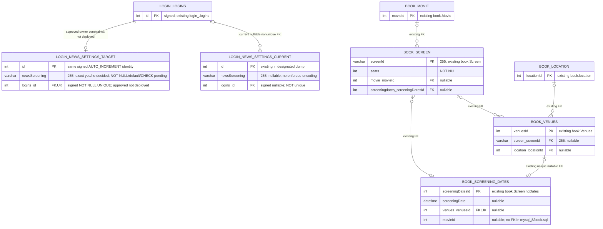

# Database schema: Screen-news WebSocket subscriptions

**Created**: 2026-10-03  
**Updated**: 2026-10-04 — required mbook persistence endpoint and deviceid/session lookup clarification; user-directed: active-list membership is sufficient WebSocket identity; owner constraints unchanged  
**Status**: Shared layout/text semantics DECIDED; `logins_id NOT NULL` + `UNIQUE (logins_id)` USER-APPROVED REQUIRED target, not deployed; preference-column hardening pending approval  
**SQL deliverable confirmed (2026-10-08)**: new full standalone schema-and-data RC, not a migration; isolated import/insertion acceptance required before final Backend Engineer review. No execution authorized by this documentation update.
**Spec**: [Screen-news subscriptions](./speckit.system.screen-news-websocket-subscriptions.specify)  
**Architecture**: [Components and flows](./speckit.system.screen-news-websocket-subscriptions.architecture.md)

## Decision and scope

**Decided by the user**: existing `login_.news_settings` is a shared per-user news-preferences
row. Currently `newsScreening` stores **literal lowercase text** `yes` = subscribed and
`no` = unsubscribed. Future columns may represent other news categories; do not build those now.
For example, each category has its own independent yes/no column in the same shared per-user row:
`newsScreening='yes'` enables screening-created/updated/deleted news for the current scope;
a hypothetical future `newsTrendin='yes'` would enable trending-movie news only. These flags are
independent, so `newsScreening='yes'` with future `newsTrendin='no'` still delivers screening news,
not trending news. `newsTrendin` is only an illustrative future column name, not an existing schema
column or approved migration/feature. Yes/no values are subscription preferences, not evidence that
news/event data exists or is available. Row existence is **not** eligibility. **USER-APPROVED REQUIRED
target**: `logins_id NOT NULL` plus `UNIQUE (logins_id)`, not currently enforced. These ensure at
most one settings row per account and an owner for every settings row (with the existing FK).
They do not create rows for all users; missing row remains off, with no blanket backfill.
Subscribe ensures a row and sets only `newsScreening='yes'`. Unsubscribe ensures/sets
`newsScreening='no'`, retaining the row and every unrelated preference column. Repeated and
concurrent operations are idempotent. Never replace the whole row or delete preferences on
unsubscribe, disconnect, logout, or session expiry.

Missing row defaults not subscribed. New managed rows initialize to `no` unless subscribe was
explicitly requested; defaults for other categories must not enable anything. Existing NULL or
unknown values never imply opt-in. Invalid/noncanonical values and duplicate rows are explicit
validation errors, logged without stored values/personal data, not silently successful off states.
Lookup failure is an error: delivery fails closed and menu reads return no fabricated `no`.
No ENUM/boolean conversion or separate subscription table is part of the active target.
This one opt-in covers scheduled-screening created/updated/deleted news on all the user's clients.
A successful unsubscribe does not remove the user's valid WebSocket registration or kill the socket;
only screening-news delivery is suppressed. The user-level preference governs all the user's devices,
while other category preferences and non-news traffic continue on their normal eligibility rules.
Re-subscribe writes `yes` and the same socket resumes subsequent screening events without reconnecting.
The value is a subscription preference, not a statement that screening news or any other category is
available or currently populated. A user with `newsScreening='yes'` may receive screening news even when
other category values are off; a user with `newsScreening='yes'` and a hypothetical future
`newsTrendin='no'` receives screening news but not trending-movie news. Independent category flags remain
separate and preserved.
A future hypothetical `newsTrendin='yes'` would be an independent subscription for trending-movie news only;
it does not enable or replace screening subscriptions. The same user can have `newsScreening='yes'` and
`newsTrendin='no'` and still receive screening news without trending-movie news. Independent flags must be
preserved when one preference changes; switching one category on or off must not alter the other category's current value.

`mbook-quarkus` MUST implement a **new authenticated endpoint to persist the subscription**;
authenticated reads for `MenuVC` remain required. These are proposed implementation, not existing
deployed endpoints. Route/method/payload and read-resource shape remain planning. The backend
acts only on the server-resolved user's shared row, never a body/query username or client ID.

WebSocket client ID is **decided: existing iOS deviceid**, reused on connect/reconnect, not a new
app ID. `SwiftCinemas/SwiftLoginScreen/ciphertext.swift:currentDeviceId()` returns
`UIDevice.current.identifierForVendor?.uuidString ?? ""`; `LoginVC.swift` and
`Networking/BackendServices.swift` use it as the login `deviceId`. Transport remains planning;
empty/unavailable value fails eligibility, and permanence across reinstalls is not guaranteed.

Required lookup boundary: **GET `/simple-service-webapp/webapi/myresource/admin`**, owned by
`simple-service-webapp-quarkus/src/main/java/com/example/rest/ImageResource.java:getSessions`
(root/REST paths in `src/main/resources/application.properties`), proxies to dalogin
**GET `/login/activeSessions`** with incoming Cookie. `dalogin-quarkus/.../servlets/ActiveSessionsServlet.java`
reads ServletContext `activeUsers`; response fields are `id` (enumeration index, **not logins.id**),
`sessionId`, `user`, `deviceId`, `creationTime`; **no status/active/expiry or account-id field**.
The simple-service `api/Sessions.java` DTO is not the proxy's wire model.
`dalogin-quarkus/.../listeners/CustomHttpSessionListener.java` registers at session creation
before login attributes, attempts same-device eviction and destruction cleanup;
`HelloWorld.java:createSession` sets user/deviceId after successful login persistence and a
30-minute inactivity interval. **User-confirmed (2026-10-04)**: list entries are authenticated
users, so fresh membership is sufficient WebSocket identity. Blank user/deviceId entries are
invalid records; creationTime is not expiry proof; results must be fresh. The map is replica-local.

The server uses the authoritative simple-web-api lookup: if the supplied deviceid matches entries
resolving to exactly one authenticated `user`, it resolves that username to `login_.logins.id`.
No separate WebSocket caller-session binding is required. No match => no delivery; lookup error,
invalid record or conflicting users => no delivery with explicit logging. Repository prior art:
`mbook-quarkus/src/main/java/com/jeet/db/DAO.java:getUser` queries Logins by user, returns an
id-zero sentinel when absent; `.../api/Logins.java:getId` is the numeric owner ID. Missing or
non-unique account resolution fails, never use list id, deviceId or login uuid as the settings FK.
Do not replace this lookup with cookie-only identity or a client-supplied username.
Accepted trust model (user-directed): membership identifies the user associated with the
deviceid, not cryptographic device ownership; anyone presenting another user's active deviceId can
be mapped to that user (documented residual risk, no independent spoof protection claimed). The
deviceid never authorizes reads/writes of `news_settings`; those use the authenticated mbook endpoint.

**Admin-list access**: authorization of the facade and upstream servlet is out of scope
(user-directed, 2026-10-04). The list is dalogin in-memory state; there is no DB query for active users,
and it is never exposed to iOS. The lookup is fresh per event, with re-lookup on reconnect;
no delivery for missing, invalid, conflicting or stale mappings or on lookup outage/denial/malformed response.
Same-device user switch discards old identity and resolves the new session's account/preference.
Disconnect removes transient registration, not settings. Reuse existing active-session metadata:
**no new persistent client table or deviceid column/FK in news_settings** is required.

This is documentation only: no migration installed, SQL executed, database connected, application
changed, or dump modified. **User-confirmed baseline**: `k8infra/mysql_8/Dump20260524.sql` is the
latest working dump and includes events. Its recorded repository contents define `login_`; this
confirmation does not establish exhaustive `book` schema/data coverage. The canonical
`mysql_8/book.sql` is separate schema evidence, not proof of the current `book` data. The evidence
below is schema metadata only; no data rows are reproduced or used to infer consent. It is not a
live-database inspection.

### SQL product and acceptance boundary

Database Engineer owns T01 generation and T10 SQL evidence in the existing tasks/plan. The user confirms the May dump is the latest working source and includes events; record its checksum and preserve a separate untouched byte-for-byte copy, including user dirty content, before generating SQL. The repository dump content covers only `login_`, while canonical `mysql_8/book.sql` is separate `book` schema evidence, not proof of the current `book` data. This settles source identity but not exhaustive schema/data coverage. Generate a separate new full RC (planned `k8infra/mysql_8/screen_news_standalone_rc.sql`), never overwrite working/original dumps. Preserve full source schema/seed/data, unrelated objects, triggers/routines, PK/FK behavior, charset/collation and the `login_`/`book` boundary; identify the actual source for any `book` schema/data needed by the full RC without inventing or silently substituting seeds.

RC alone must restore a fresh empty MySQL target without source/migration/previous-schema dependencies. ALTER examples below and `04-db-migration-runbook.md` are intermediate delta/rollout references, **not the final product or required RC import steps**. Only approved bounded changes are included; preference NOT NULL/default/CHECK, cleanup/backfill and unrelated redesign remain unapproved.

After all edits: statically map the real final entities/API models and DAO reads/writes to RC tables/columns (actual/implicit annotations, types, nullability, ids/defaults, FKs, uniqueness and exact String yes/no), including `eventType` persistence/transient treatment without a repeat event-sending runtime test, then execute full RC-only import and representative insertion checks in isolated disposable MySQL before T12. T10 defines required intact-data/object comparisons, duplicate/NULL/orphan-owner detection with no silent cleanup, positive writes, negative duplicate/NULL/missing-FK checks, generated ids/defaults and trigger checks. Record SQL versus real ORM roundtrip evidence honestly; matching parameterized SQL is allowed without Java/runtime tests, not proof that the API/ORM ran.

Existing `CREATE DATABASE`/`USE` and qualified references make a default-schema switch on a shared server unsafe. Require a disposable instance without live connectivity/credentials, or reviewed complete retargeting plus grants restricted to disposable schemas. Never restore over working/live DBs. SQL failure requires scoped fixes, RC regeneration and fresh-target retest, not hand repairing the target. The safe isolated harness and full dual-schema/model alignment remain acceptance prerequisites; source identity is user-confirmed. T11 still requires separate approval; no live inspection, migration or rollout is authorized here.

**Preference toggle behavior (user-level, not connection-level)**: successful unsubscribe writes
`newsScreening='no'` and does not close, disconnect, reconnect, or remove an otherwise valid
WebSocket connection or registry entry for the device. The user-level subscription suppresses
subsequent `created`/`updated`/`deleted` screening-news delivery on all of that user's devices,
while other independently subscribed categories and existing non-news traffic continue as otherwise
eligible. Re-subscribe writes `newsScreening='yes'` and the next screening event is delivered over
that same open socket without reconnecting. Socket lifetime remains governed by the normal
disconnect/logout/session-expiry/error-handling rules; a preference toggle is not a promise to keep a
socket alive on invalid auth or failed transport.

## Current schema and exact evidence

Paths below are repository-relative. No seed rows or credentials are part of this design.

| Source | Relevant facts and limitations |
|---|---|
| `k8infra/mysql_8/Dump20260524.sql:1–2,5` (**designated snapshot**) | Database `login_`, default charset `utf8mb3`. The dump contains only `login_`; it has no `book` schema. |
| `Dump20260524.sql:301–316` | `login_.logins`: `id INT NOT NULL AUTO_INCREMENT` (signed), sole PK. `hash_ CHAR(255) NOT NULL`; nullable `user VARCHAR(255)`, `uuid CHAR(255)`, `email CHAR(255)`, `TIME_ TIMESTAMP` (default/on-update current time), `profilePicture VARCHAR(1024)`. String columns explicitly `utf8mb3`/`utf8mb3_bin`. Unique keys on email, uuid, user (not subscription identities). `ENGINE=InnoDB DEFAULT CHARSET=utf8mb3 COLLATE=utf8mb3_bin`. |
| `Dump20260524.sql:337–339,354–358` | `logins` triggers `insert_guid` (BEFORE INSERT, sets uuid) and `vouchers_trigger` (AFTER INSERT, inserts a voucher). Neither touches news settings or subscriptions. |
| `Dump20260524.sql:372–379` | **`login_.news_settings` is present**: `id INT NOT NULL AUTO_INCREMENT` (signed) sole PK; `newsScreening VARCHAR(255) DEFAULT NULL`; `logins_id INT DEFAULT NULL` (signed, **nullable**); non-unique `KEY FK_NEWS_SETTINGS_ON_LOGINS (logins_id)`; `CONSTRAINT FK_NEWS_SETTINGS_ON_LOGINS FOREIGN KEY (logins_id) REFERENCES logins (id)` with no explicit actions (MySQL default RESTRICT/NO ACTION). No unique key on `logins_id`, no NOT NULL, no value CHECK. `ENGINE=InnoDB DEFAULT CHARSET=utf8mb3` with **unspecified collation** (the MySQL 8.0 utf8mb3 default is utf8mb3_general_ci; this is not an explicit dump clause), unlike `logins`' explicit `utf8mb3_bin`. No trigger is defined on it. |
| `Dump20260524.sql:386–389` | The `news_settings` data section contains no INSERT statements. This is a snapshot fact only: it does not prove live emptiness and is not used to infer meaning or to backfill. |
| `Dump20260524.sql` (all 11 CREATE TABLE statements) | Tables: device_states, devices, events, events_states, forgotpsw, last_seen, logins, news_settings, tokens, voucher_states, vouchers. No separate subscription table; shared news_settings is the decided target. |
| `Dump20260524.sql:653–669` | `delete_user` deletes from `logins` and `vouchers` but not `news_settings`; an existing `news_settings` row for that user would therefore block deletion under the default FK action. |
| `k8infra/mysql_8/login.sql:301–316,372–379` | Deployment copy; `logins`/`news_settings` DDL differs from the dump only in indentation whitespace. |
| `mysql_8/login.sql:178–193` | Root script `logins` matches the dump's identity metadata (signed INT PK; InnoDB/utf8mb3/`utf8_bin`). It has **no** `news_settings` DDL: a script-to-snapshot drift, not evidence of absence. Earlier wording that treated news_settings as "deployment-copy only" is superseded by the designated dump. |
| `mbook-quarkus/src/main/java/com/jeet/broadcasting/eventModel/NewsSettings.java:8–19` | Maps `news_settings`: identity-generated Java `int id`, `String newsScreening`, eager `ManyToOne` to `Logins` via `logins_id`, cascades PERSIST/REFRESH. No unique/non-null user constraint or defined text encoding. Registered in `mbook-quarkus/src/main/resources/hibernate.cfg.xml:29`. |
| `mbook-quarkus/src/main/java/com/jeet/api/Logins.java:5–15,18–24` | Maps `logins`, Java `int id`, getter `getId()`. SQL DDL, not entity generation annotations, governs actual identity metadata. |
| `mysql_8/book.sql:170–180` (not covered by the dump) | `book.Screen`: `screenId VARCHAR(255)` PK, `seats INT NOT NULL`, nullable signed INT `movie_movieId`, `screeningdates_screeningDatesId`. Indexed FKs to `Movie.movieId` and `ScreeningDates.screeningDatesId`, both ON DELETE/UPDATE CASCADE. InnoDB/latin1. Unchanged event-domain table, not subscription storage. |
| `mysql_8/book.sql:200–212` | `book.ScreeningDates`: signed auto-increment `screeningDatesId INT` PK, nullable `screeningDate DATETIME`, `venues_venuesId INT`, `movieId INT`. Unique keys on screeningDatesId and venues_venuesId; FK only on venues_venuesId to `Venues.venuesId`, cascading delete/update. No FK for its movieId in this DDL. InnoDB/latin1. Unchanged. |
| `mysql_8/book.sql:113–123,83–93,337–350` | Related existing keys: `Movie.movieId`, `location.locationId`, `Venues.venuesId` are signed auto-increment INT PKs. Venues has nullable, indexed `screen_screenId VARCHAR(255)` FK to Screen (DELETE/UPDATE CASCADE) and `location_locationId INT` FK to location (UPDATE CASCADE, default delete restriction). None is a subscription key; all unchanged. |

## Approved required target versus pending hardening

| Requirement | Current snapshot | Target and approval status (not deployed) |
|---|---|---|
| Preference lookup | Indexed non-unique `logins_id`; nullable free text | Read `newsScreening` by session-resolved user; only byte-exact `yes` enables delivery |
| At most one shared row per account | Duplicates permitted | **USER-APPROVED REQUIRED** `UNIQUE (logins_id)` after explicit reviewed reconciliation |
| Every row has an owner | Nullable FK permits ownerless rows | **USER-APPROVED REQUIRED** signed `logins_id INT NOT NULL`, existing FK retained |
| Default off and canonical text | `newsScreening VARCHAR(255) DEFAULT NULL`; no validation | Exact yes/no semantics decided; same VARCHAR with `NOT NULL DEFAULT 'no'` and enforced CHECK if supported remain **pending approval** |
| Other categories preserved | Shared table/entity exists, no reader/writer | Update only newsScreening, omit unrelated columns on insert, never delete/replace the row for opt-out |

The user has settled the storage layout and required owner constraints. Preference-column
NOT NULL/default/CHECK proposals remain pending approval; rollout, preflight/reconciliation, and
lifecycle policy remain to plan. There is no dedicated-table-versus-reuse approval question.
Do not reinterpret existing arbitrary text or row presence as consent.

## Target ER view (relevant subset, approved versus pending; not deployed)



Prefixes distinguish schemas, not literal table names. CURRENT and TARGET are two views of
the **same existing news_settings table**, not two tables to create. Current cardinality reflects
the nullable/non-unique FK; target permits zero or one shared row per existing user. Missing row
is off. There is no relationship between these preferences and `book` tables: this is global
screen-news opt-in, not per-screen subscriptions.

## Illustrative ALTER for approved owner constraints (NOT EXECUTED; NOT a migration)

This illustrates **only the USER-APPROVED REQUIRED owner constraints** on the existing table.
It is not deployment authorization; migration planning and the preflight below are still required.
Retain all shared preference columns. Preference-column NOT NULL/default/CHECK are not included.

```sql
-- ILLUSTRATIVE ONLY — NOT EXECUTED; reconcile NULL/duplicate owners before migration.
ALTER TABLE `login_`.`news_settings`
  MODIFY COLUMN `logins_id` INT NOT NULL,
  ADD UNIQUE KEY `UK_NEWS_SETTINGS_LOGINS_ID` (`logins_id`);
```

- T01 uses `UK_NEWS_SETTINGS_LOGINS_ID` consistently for the RC/intermediate delta. The older rollout runbook's `uq_news_settings_logins` denotes the same uniqueness requirement, not a second index to add.
- Preserve the signed INT auto-increment `id` PK. Signed INT `logins_id` matches `logins.id`;
  it is not a client ID, UUID text, or a new subscription identity. Approved NOT NULL + UNIQUE
  enforce at most one owned shared row per account, not a row for every account. The unique index
  can satisfy FK/lookup needs; the ALTER does not request removal of the existing named non-unique
  index or FK, or change the id PK. Verify index compatibility in migration planning; no index cleanup.
- Preserve InnoDB/utf8mb3 and current table collation unless separately reviewed. Integer FK
  columns have no character collation to match. `logins`' utf8mb3_bin does not establish the
  settings column collation. Case-insensitive comparisons can accept `YES`, and PAD SPACE
  comparisons (even some binary collations) can accept trailing spaces. The pending CHECK proposal
  uses variable binary comparison to reject uppercase/whitespace variants, without changing stored VARCHAR.
  Application validation must also compare exact text; do not trim/lowercase unknown values.
- **Pending CHECK proposal, not approved by this confirmation**: enforced CHECK constraints require MySQL **8.0.16 or later**.
  Earlier versions parse/ignore CHECK. The dump's server version is 8.0.45, but this is not a live
  version check. Verify exact deployment version and enforcement before proposing rollout;
  unsupported enforcement is a planning blocker, not permission to claim constraints exist.
  NOT NULL is also needed: CHECK alone would allow NULL through SQL's UNKNOWN result.
- RESTRICT/NO ACTION remains the existing FK default action, not a new lifecycle rule.
  Account deletion is already blocked by any settings row, including a `no` row. Approved
  account-deletion/retention handling still needs planning; do not silently introduce CASCADE.
  No trigger/ORM cascade or automatic opt-in on account creation is needed.

### Preflight and reconciliation before hardening

In a separately authorized investigation, compare live version/SHOW CREATE TABLE, keys, signedness,
engine/charset/collation, FK actions, triggers, and grants with the dump and canonical scripts.
Assess aggregate duplicate-user counts, NULL-owner counts, invalid/NULL newsScreening counts,
and unexpected FK inconsistencies without exposing data values or personal information.
Strict validation must include uppercase, whitespace, empty and other noncanonical text.
Review any future category columns/defaults as shared preferences, not screening flags.

Duplicate rows may hold different unrelated preferences; never delete one arbitrarily, pick a
winner, merge blindly, or enable news because any row happens to exist. Ownerless rows and
unknown values need explicit owner-approved reconciliation/retention decisions. Preserve all
unrelated columns; NULL/unknown is not consent and must never be auto-opted-in. Constraint rollout
must wait for a reviewed, authorized reconciliation plan and zero remaining violations. Snapshot
emptiness does not prove live cleanliness. No cleanup/backfill/deployment SQL is authorized here.

## Proposed bound operations and transaction semantics

All `?` markers below bind the same **server-resolved `logins.id`**, never request-body/query
user IDs, names, or client IDs. Authenticate first and verify an existing account. Translate only
a validated subscribe/unsubscribe intent to the literal constants below; invalid input is an error.
These unexecuted templates assume the approved owner NOT NULL/UNIQUE constraints have been
deployed after reconciliation and require exact application validation. They do not imply approval
of preference-column NOT NULL/default/CHECK proposals. Do not use them on the current non-unique schema.

### Subscribe (ensure shared row, set only newsScreening)

```sql
START TRANSACTION;
SELECT `id` FROM `login_`.`logins` WHERE `id` = ? FOR UPDATE;
-- Require exactly one account; otherwise abort, do not treat as unsubscribed.
SELECT `newsScreening` FROM `login_`.`news_settings`
WHERE `logins_id` = ? FOR UPDATE;
-- Validate: zero rows is allowed; one row must be exact yes/no.
-- Invalid value or multiple rows => rollback and explicit validation error.
INSERT INTO `login_`.`news_settings` (`logins_id`, `newsScreening`) VALUES (?, 'yes')
ON DUPLICATE KEY UPDATE `newsScreening` = 'yes';
SELECT `newsScreening` FROM `login_`.`news_settings` WHERE `logins_id` = ?;
-- Require exactly one row with exact yes; stage response, do not acknowledge yet.
COMMIT;
```

### Unsubscribe (retain shared row, set only newsScreening)

```sql
START TRANSACTION;
SELECT `id` FROM `login_`.`logins` WHERE `id` = ? FOR UPDATE;
-- Require exactly one account; otherwise abort.
SELECT `newsScreening` FROM `login_`.`news_settings`
WHERE `logins_id` = ? FOR UPDATE;
-- Same validation guard: missing row allowed, invalid/duplicate data => error.
INSERT INTO `login_`.`news_settings` (`logins_id`, `newsScreening`) VALUES (?, 'no')
ON DUPLICATE KEY UPDATE `newsScreening` = 'no';
SELECT `newsScreening` FROM `login_`.`news_settings` WHERE `logins_id` = ?;
-- Require exactly one row with exact no; stage response until commit.
COMMIT;
```

Initialization without a subscribe request explicitly writes `no` (a SQL default remains pending); if a shared row
already exists, initialization must leave its current preference intact (not reuse the
unsubscribe operation). Future category defaults must never opt in, and unrelated columns are
omitted from these INSERTs and from their UPDATE arms. Zero affected rows for a repeated same-value
write is not failure; validate the state and commit.

### Read/menu/delivery gate (validate text, do not test row existence)

```sql
SELECT `newsScreening` FROM `login_`.`news_settings` WHERE `logins_id` = ?;
```

Successful read mapping: zero rows => enabled false (missing preference, no implicit write);
one row with byte-exact `yes` => enabled true; one row with byte-exact `no` => enabled false.
NULL/unknown/noncanonical text or multiple rows => explicit validation/integrity error, no
successful enabled boolean. SQL/connection failure => error, never fabricated off. Menu shows
error/retry; gate suppresses delivery and logs only an error category. Do not use `EXISTS`,
`COALESCE`, or a permissive collation comparison to conceal invalid state as a successful read.

- Same connection/transaction for each write sequence; release the account lock on commit or
  rollback. All subscription writers take the same parent-row lock, serializing subscribe versus
  unsubscribe even when no child exists. Approved target user uniqueness also protects concurrent inserts.
  Shared preference writers must follow this locking order; no whole-entity/whole-row replacement.
  Locking the parent does not fire login INSERT triggers or update its timestamp.
- Repeated subscribe leaves one row with yes; repeated unsubscribe leaves the same row with no
  (or ensures a missing row with no). Opposite writes follow database serialization order, not
  device tap/wall-clock order. A later device change may supersede a committed response.
- The upsert changes **only newsScreening**, never the id, user FK, or other preferences. It uses
  MySQL 8-compatible literal syntax, no deprecated `VALUES()` or newer row-alias requirement.
  The id PK is generated, not client-supplied; the only intended duplicate conflict is the
  approved target UNIQUE logins_id. Verify this assumption against live metadata and reassess if future
  unique constraints/triggers are introduced; unrelated duplicate conflicts must be errors, not
  accidental updates of a different shared row. An explicit scoped UPDATE after parent locking
  is an alternative when avoiding an upsert conflict ambiguity.
  Never use `INSERT IGNORE`; never swallow FK, permission, syntax, connection, or other failures.
  Deadlock/lock-timeout retries, if implemented, are bounded whole-transaction retries after
  rollback, not conversion of a failed operation into success.
- Only acknowledge write success after successful COMMIT. On known failures roll back;
  a lost response/connection during commit has an **unknown outcome**, not proof of rollback.
  Reload server state after recovery rather than claiming the preference is unchanged or blindly
  replaying an old intent after a newer device change. Keep the last confirmed UI state with an
  error until reconciliation (FR-018/FR-021).
- Reads use a fresh statement snapshot on the authoritative database after confirmation:
  autocommit or a fresh short READ COMMITTED transaction. Do not reuse a long-lived
  REPEATABLE READ snapshot, stale cache, ORM-cached association, or lagging replica for the
  recipient gate. One validated preference read per resolved user per event may serve its eligible devices.
  Lookup/validation failure is an error: suppress delivery and report it, never invent a no value.
  Fresh unique active-list membership of the deviceid resolves the user (no separate caller-session
  binding); shared row presence alone is insufficient. On session API failure suppress
  delivery explicitly, never authorize from stale identity or fabricate a successful off state.

## Unchanged behavior and operational gates

- Preserve `login_` versus `book` ownership. No cross-schema FK, screening/admin table change,
  booking lock/transaction change, outbox, persisted client table, or new event-storage design.
- Existing login INSERT triggers `insert_guid`/`vouchers_trigger`
  (`Dump20260524.sql:337–339,354–358`) remain untouched; no subscription is inserted by them.
  `logout_device` (`Dump20260524.sql:1031`) changes device/token state, not subscription state.
  Disconnect, logout, session expiry, restart, or reinstall never remove the row or reset its value.
- `delete_user` (`Dump20260524.sql:653–669`) physically deletes logins but not news_settings.
  The existing FK (`:378`, default restriction) already blocks account deletion if any shared
  settings row exists, even with no. Planning needs an approved lifecycle/retention transaction;
  do not modify the routine, add CASCADE, or delete shared preferences here.
- No new subscription table, automatic backfill from login/device/settings presence, or
  reinterpretation of ambiguous newsScreening text. Missing users' preferences remain off;
  existing canonical yes/no values follow the decided semantics after integrity validation.
- Before any separately authorized implementation/deployment, inspect live metadata only:
  MySQL version, SHOW CREATE TABLE for logins and news_settings,
  PK/type/signedness, engine/charset/collation, FK actions, indexes, triggers, and schema grants.
  Compare live metadata with the designated dump snapshot; do not run the destructive seed dumps as a migration.
  Do not use `IF NOT EXISTS` to mask drift or run illustrative DDL without migration authorization.
- Future isolated tests should cover repeated/concurrent yes/no writes, preservation of row id
  and unrelated category values, missing-row defaults/initialization, invalid values and lookup
  errors, duplicate/NULL preflight and rejection of NULL/duplicate owners by target constraints,
  exact CHECK enforcement if separately approved, cross-user isolation, failed FK/commit,
  ambiguous commit recovery, all three events on every eligible client, and lifecycle policy.
  Identity cases also cover unique member + yes delivered without a socket session credential,
  no active match denied, blank metadata, conflicting users, stale mapping, logout/expiry/removal/replacement,
  same-device user switch, reconnect freshness, session API outage/denial/malformed response,
  missing/non-unique account resolution, and no admin-list exposure to iOS.
  No runtime tests or live schema checks ran here.
- Rollback planning must preserve the shared row and every preference if rollout is reverted;
  disabling this feature must not restore unfiltered broadcasting. No destructive rollback SQL.

## Validation and outstanding assumptions

Validation scope: existing layout check and local document links/fences/whitespace, plus logical
SQL/Mermaid source review against the dump metadata and canonical scripts. Review includes
signed keys, preserved FK/triggers, baseline versus approved/pending constraints, byte-exact text validation,
MySQL CHECK version precondition, idempotent scoped writes, and the dual-schema boundary.
SQL is not parser-tested/executed; Mermaid is not renderer-tested. No installations or DB connections.

Outstanding: live drift after the 2026-05-24 snapshot; migration/reconciliation authorization;
account deletion/retention policy; replica coverage. Resolved: the subscription API is
`GET`/`PUT /mbook-1/rest/news-settings/screen` (via dalogin `/login/newsSettings/screen`), the transport is `?deviceId=`,
there is no CHECK/DEFAULT on `newsScreening`, and admin-list authorization is out of scope. The migration artifact is task T01. Deviceid reuse, shared-row layout and literal
yes/no semantics, required owner NOT NULL/UNIQUE constraints and membership-only WebSocket identity
(with its accepted residual risk) are approved, not outstanding choices.
These remaining questions do not authorize
production changes.
